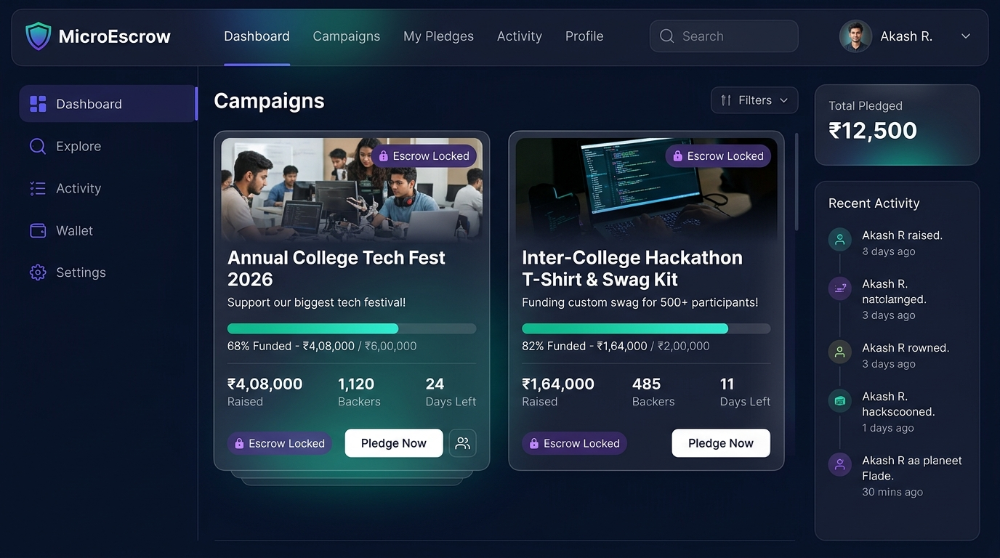
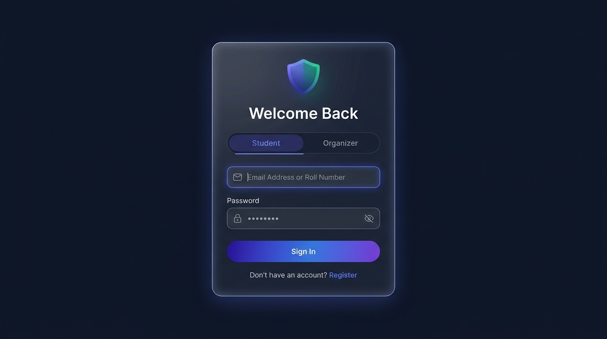

# 🛡️ MicroEscrow

**UPI-First Micro-Pledge Platform for College Events & Festivals**

MicroEscrow is an escrow-backed crowdfunding platform designed for Indian college campuses. Students can pledge micro-amounts (via UPI) toward campus events — tech fests, hackathons, cultural nights — with funds locked safely in a virtual escrow vault until the organizer's funding threshold is met. If the goal isn't reached by the deadline, pledges are auto-refunded.

---

## ✨ Key Features

| Feature | Description |
|---|---|
| 🔒 **Escrow Vault** | Every pledge is locked with a cryptographic vault hash receipt — no direct vendor payouts until the threshold is met |
| 👥 **Role-Based Auth** | Separate dashboards for **Students** (pledge & track) and **Organizers** (create, manage, disburse/refund) |
| 📊 **Live Campaign Tracking** | Real-time progress bars, backer counts, and countdown timers for every campaign |
| 🎫 **Tiered Pledging** | Students choose from predefined tiers (General Pass, VIP + Hoodie Pass) or enter a custom amount |
| 💸 **Disburse & Refund** | Organizers can release escrowed funds to vendors or trigger auto-refund to student UPI handles |
| 🔄 **In-Memory Fallback** | Works 100% without MySQL — automatically falls back to a high-speed in-memory store for demos & prototyping |
| 🗄️ **MySQL Persistence** | Full relational schema with users, campaigns, and pledges tables when MySQL is available |

---

## 📸 Screenshots

<p align="center">
  
  <br />
  <em>Student Dashboard — Live campaign cards with escrow progress bars, backer counts & countdown timers</em>
</p>

<p align="center">
  
  <br />
  <em>Login Portal — Role-based authentication for Students & Organizers</em>
</p>

---

## 🏗️ Tech Stack

- **Backend:** Node.js, Express 5
- **Database:** MySQL 8.0+ (with automatic in-memory fallback)
- **Frontend:** HTML, Tailwind CSS (CDN), Vanilla JavaScript
- **Font:** Inter (Google Fonts)
- **Architecture:** MVC (Model-View-Controller) with modular API routing

---

## 📁 Project Structure

```
MicroEscrow/
├── backend/
│   ├── api/
│   │   ├── index.js              # Central API router hub
│   │   ├── authRoutes.js         # Auth endpoints
│   │   ├── campaignRoutes.js     # Campaign CRUD endpoints
│   │   └── pledgeRoutes.js       # Pledge submission endpoints
│   ├── controllers/
│   │   ├── authController.js     # Login, register, profile logic
│   │   ├── campaignController.js # Campaign business logic
│   │   └── pledgeController.js   # Pledge & vault hash logic
│   ├── database/
│   │   ├── database.js           # MySQL pool + in-memory fallback
│   │   └── schema.sql            # Full database schema with seed data
│   └── app.js                    # Express server entry point
├── frontend/
│   ├── components/
│   │   ├── auth-view.html        # Login/register UI
│   │   ├── header.html           # Navigation header
│   │   ├── footer.html           # Page footer
│   │   ├── modals.html           # Pledge & campaign modals
│   │   ├── student-view.html     # Student dashboard
│   │   └── organizer-view.html   # Organizer dashboard
│   ├── css/
│   │   └── style.css             # Custom styles & animations
│   └── js/
│       ├── api.js                # API client utility
│       ├── app.js                # App initialization
│       ├── auth.js               # Auth state management
│       ├── campaign.js           # Campaign rendering
│       ├── main.js               # Main entry & router
│       ├── organizer.js          # Organizer dashboard logic
│       ├── pledge.js             # Pledge submission logic
│       └── vaultPass.js          # Vault hash receipt generator
├── index.html                    # Main SPA entry page
├── login.html                    # Standalone login page
├── .env.example                  # Environment variable template
├── .gitignore
├── package.json
└── README.md
```

---

## 🚀 Getting Started

### Prerequisites

- [Node.js](https://nodejs.org/) v18 or higher
- [MySQL 8.0+](https://dev.mysql.com/downloads/) *(optional — app works without it)*

### 1. Clone the Repository

```bash
git clone https://github.com/ProCoder80/MicroEscrow.git
cd MicroEscrow
```

### 2. Install Dependencies

```bash
npm install
```

### 3. Configure Environment

```bash
cp .env.example .env
```

Edit `.env` with your MySQL credentials:

```env
PORT=5000
DB_HOST=localhost
DB_PORT=3306
DB_USER=root
DB_PASSWORD=your_mysql_password
DB_NAME=microescrow
```

> **💡 No MySQL?** No problem — the app automatically activates an in-memory fallback store so all APIs and the frontend remain fully operational.

### 4. Start the Server

```bash
npm start
```

The server starts at **http://localhost:5000** and the database initializes automatically (tables + seed data).

---

## 🔌 API Reference

Base URL: `http://localhost:5000/api`

### Authentication

| Method | Endpoint | Description |
|--------|----------|-------------|
| `POST` | `/auth/login` | Role-based login (student/organizer) |
| `POST` | `/auth/register` | New user registration |
| `GET` | `/auth/me/:id` | Get user profile |
| `GET` | `/auth/my-pledges/:userId` | Get student's pledge history |

### Campaigns

| Method | Endpoint | Description |
|--------|----------|-------------|
| `GET` | `/campaigns` | List all campaigns with stats |
| `GET` | `/campaigns/:id` | Get single campaign |
| `POST` | `/campaigns` | Create new campaign |
| `PATCH` | `/campaigns/:id/threshold` | Update target amount |
| `POST` | `/campaigns/:id/disburse` | Release funds to vendor |
| `POST` | `/campaigns/:id/refund` | Trigger auto-refund |
| `DELETE` | `/campaigns/:id` | Delete campaign |
| `POST` | `/campaigns/reset-demo` | Reset to seed data |

### Pledges

| Method | Endpoint | Description |
|--------|----------|-------------|
| `GET` | `/pledges` | List all pledges |
| `GET` | `/pledges/campaign/:campaignId` | Pledges for a campaign |
| `POST` | `/pledges` | Submit a new pledge |

### Health Check

| Method | Endpoint | Description |
|--------|----------|-------------|
| `GET` | `/health` | Platform health status |

---

## 🎓 Demo Accounts

The app ships with pre-seeded accounts for testing:

| Role | Email | Password |
|------|-------|----------|
| **Student** | `student@campus.edu` | `student123` |
| **Student** | `priya@campus.edu` | `student123` |
| **Organizer** | `organizer@campus.edu` | `organizer123` |

---

## 🧪 How It Works

```
Student pledges ₹799               Organizer reviews
        │                                  │
        ▼                                  ▼
  ┌─────────────┐     Threshold     ┌──────────────┐
  │ Escrow Vault │ ── reached? ──▶  │   Disburse   │ → Vendor gets paid
  │  (Locked)    │                  │   to Vendor   │
  └─────────────┘                  └──────────────┘
        │
        │  Deadline passed &
        │  threshold NOT met
        ▼
  ┌──────────────┐
  │  Auto-Refund │ → Students get money back
  └──────────────┘
```

---

## 📜 License

This project is licensed under the [ISC License](LICENSE).

---

## 🤝 Contributing

Contributions are welcome! Feel free to open issues or submit pull requests.

1. Fork the repository
2. Create your feature branch (`git checkout -b feature/amazing-feature`)
3. Commit your changes (`git commit -m 'Add amazing feature'`)
4. Push to the branch (`git push origin feature/amazing-feature`)
5. Open a Pull Request

---

<p align="center">
  Built with ❤️ for campus communities
</p>
